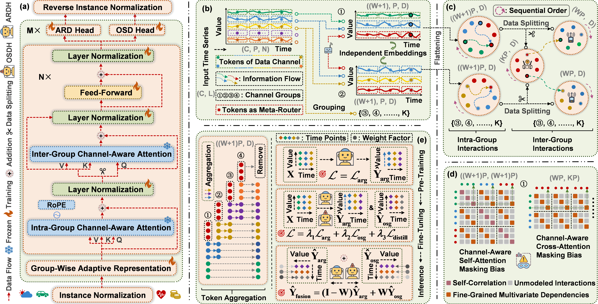

# TimeCAP: A Channel-Aware Pre-Training Framework for Multivariate Time Series Forecasting
TimeCAP introduces the first purely channel-aware pre-training framework for multivariate time series and systematically integrates the complementary advantages of autoregressive and one-shot generative paradigms. This design establishes a new modeling perspective for future time series foundation models by explicitly capturing inter-channel dependencies during pre-training rather than treating channels as independent signals.

This repository corresponds to the official implementation of the AAAI 2026 paper “TimeCAP: A Channel-Aware Pre-Training Framework for Multivariate Time Series Forecasting.” 

<p align="center">
  
</p>

## Citation

If you find this work useful, please consider citing our paper:

```bibtex
@inproceedings{ren2026timecap,  
  title={TimeCAP: A Channel-Aware Pre-Training Framework for Multivariate Time Series Forecasting},  
  author={Ren, Chuanru and Lu, Yao and Huang, Tianjin and Zheng, Haowen and Zhu, Hengde and Li, Yunyin and Li, Hengxiao and Liu, Lu},  
  booktitle={Proceedings of the AAAI Conference on Artificial Intelligence},  
  volume={40},  
  number={30},  
  pages={25108--25116},  
  year={2026}  
}  

